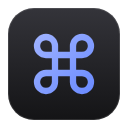
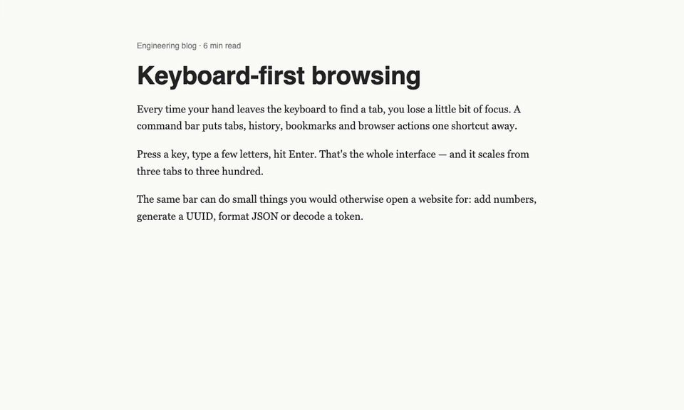
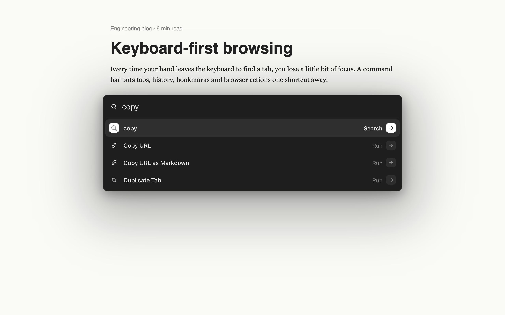
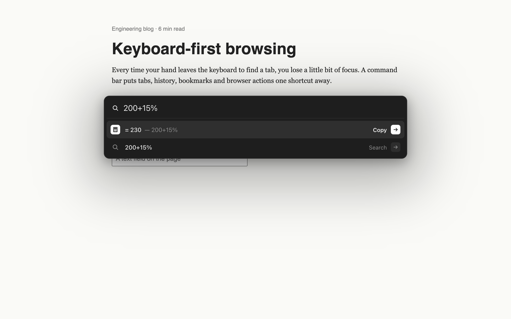
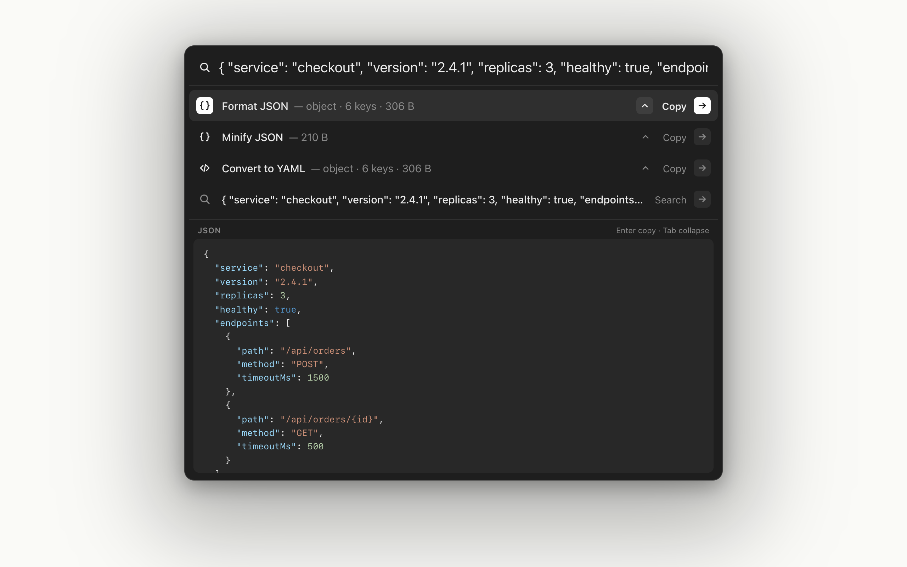
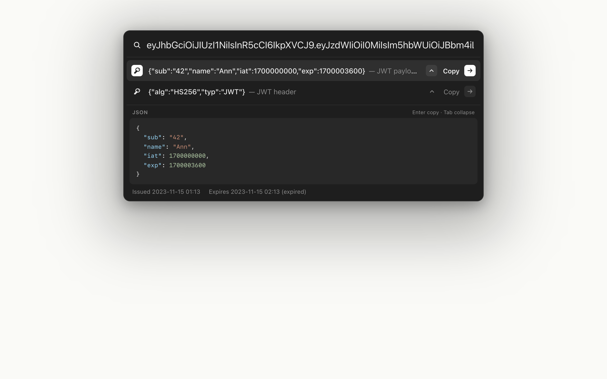
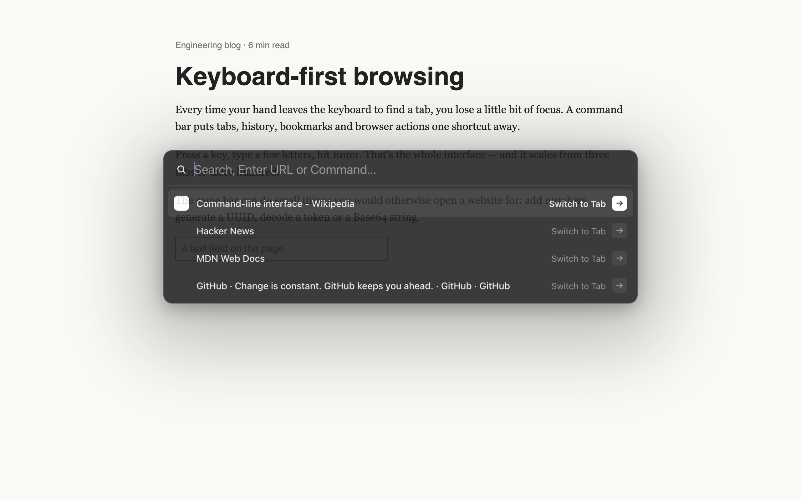
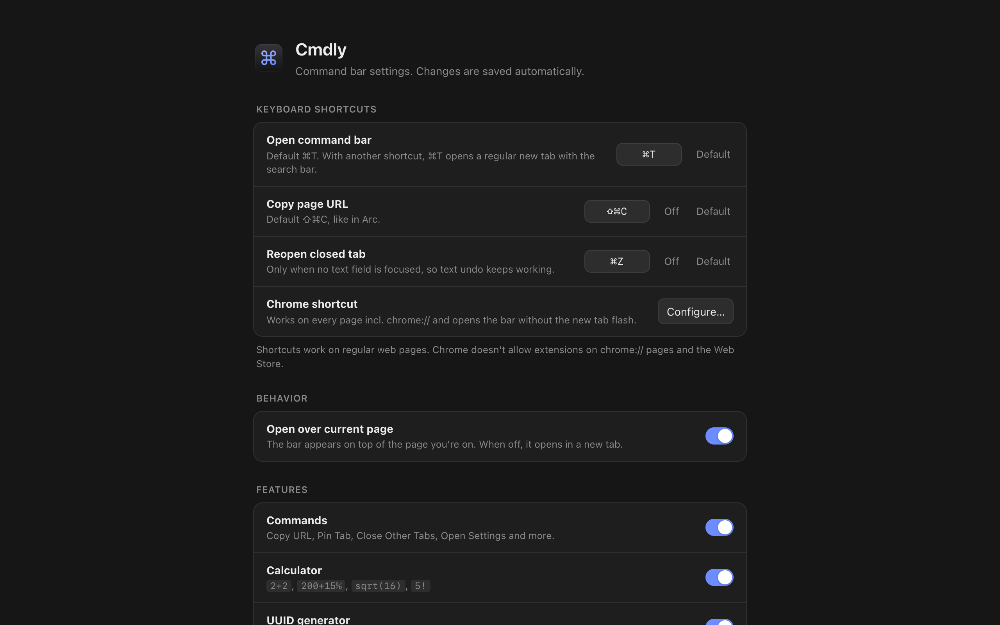

<p align="center">
  
</p>

<h1 align="center">Cmdly</h1>

<p align="center">
  <b>An Arc-style command bar for Chrome.</b><br>
  Press <kbd>⌘</kbd> <kbd>T</kbd> — search tabs, history and bookmarks, run browser commands,
  calculate, decode. Without leaving the page.
</p>

<p align="center">
  <a href="#installation">Installation</a> ·
  <a href="#features">Features</a> ·
  <a href="#keyboard-shortcuts">Shortcuts</a> ·
  <a href="#development">Development</a> ·
  <a href="PRIVACY.md">Privacy</a>
</p>

<p align="center">
  
  
  
  
</p>

<p align="center">
  
</p>

## Why

Arc's command bar was the best part of the browser: one shortcut, type a few letters, Enter.
Arc is being discontinued, Chrome's address bar is not the same thing. Cmdly brings that workflow
to Chrome — the bar appears **on top of the page you're on**, and a new tab is opened only when
you actually navigate somewhere.

## How it works

<table>
  <tr>
    <td width="50%" valign="top">
      <b>Commands, calculator, UUID</b><br>
      <sub>Type what you want to do. Enter runs a command or copies the result.</sub><br><br>
      
    </td>
    <td width="50%" valign="top">
      <b>JSON, YAML and JWT viewer</b><br>
      <sub>Paste data, press <kbd>Tab</kbd> to expand the formatted result below.</sub><br><br>
      
    </td>
  </tr>
</table>

## Features

|                       |                                                                                                                                                             |
|-----------------------|-------------------------------------------------------------------------------------------------------------------------------------------------------------|
| **Search everything** | Open tabs, bookmarks and history in one list. Pick an open tab to switch to it instead of opening a duplicate.                                              |
| **Commands**          | Copy URL, Copy as Markdown, Pin/Unpin, Mute, Duplicate, Close other tabs, Move to new window, Reopen closed tab, Bookmark, open History/Downloads/Settings… |
| **Calculator**        | `2+2`, `200+15%`, `sqrt(16)`, `5!`, `2^10`, `3x4`. Enter copies the result.                                                                                 |
| **JSON / YAML**       | Paste JSON or YAML: format, minify, convert JSON ⇄ YAML. <kbd>Tab</kbd> expands a syntax-highlighted viewer under the results.                              |
| **Dev tools**         | `uuid` / `uuid 5`, `b64 text` / `unb64 …`, `url text` / `unurl …`. Paste a JWT to see payload, header and readable `iat`/`exp` dates.                       |
| **Shortcuts**         | `⇧⌘C` copies the page URL, `⌘Z` reopens the last closed tab — like in Arc. All configurable.                                                                |
| **Settings**          | Turn every feature on/off, rebind shortcuts, pick theme, accent color, position and width. Export / import as JSON.                                         |
| **Private**           | No network requests, no analytics. Everything stays in your browser.                                                                                        |

# Screenshots

#### Commands — type what you want to do

<p>
<p align="center">
</p>

---

#### Calculator — Enter copies the result

<p>
<p align="center">
</p>

---

#### Pasted JSON — format, minify or convert to YAML

<p>
<p align="center">
</p>

---

#### JWT payload with readable dates

<p>
<p align="center">
</p>

---

#### The bar over any page — open tabs first

<p>
<p align="center">
</p>

---

#### Settings — features, shortcuts, appearance

<p>
<p align="center">
</p>

## Installation

Cmdly is not in the Chrome Web Store yet. Install it locally in a minute.

### Option 1 — download a release (no build tools needed)

1. Download `cmdly-<version>.zip` from the [latest release](https://github.com/ogbozoyan/cmdly/releases/latest) and
   unzip it.
2. Open `chrome://extensions` and turn on **Developer mode** (top right).
3. Click **Load unpacked** and select the unzipped folder.
4. Press <kbd>⌘</kbd> <kbd>T</kbd> on any web page. If Chrome asks whether to keep the changed new tab page, choose
   **Keep it**.

### Option 2 — build from source

Requires Node.js 22+.

```bash
git clone https://github.com/ogbozoyan/cmdly.git
cd cmdly
npm install
npm run build
```

Then **Load unpacked** → select the `dist/` folder (steps 2–4 above).

To update: `git pull && npm run build`, then click ↻ on the Cmdly card in `chrome://extensions`.

## Usage

Press <kbd>⌘</kbd> <kbd>T</kbd> and start typing.

| Type                           | You get                                                                        |
|--------------------------------|--------------------------------------------------------------------------------|
| `git`                          | Open tabs, bookmarks and history matching "git"                                |
| `github.com`                   | Open the address in a new tab                                                  |
| `how to ...`                   | Search with your default search engine                                         |
| `copy`, `pin`, `close`, `mute` | Commands for the current tab                                                   |
| `200+15%`                      | `= 230` — Enter copies it                                                      |
| `uuid`, `uuid 5`               | Fresh UUID v4                                                                  |
| `b64 hello` / `unb64 aGVsbG8=` | Base64 encode / decode                                                         |
| `url a b&c` / `unurl a%20b`    | URL encode / decode                                                            |
| `eyJhbGciOi…`                  | Decoded JWT payload, header and expiry — <kbd>Tab</kbd> to expand              |
| paste `{"a": 1}` or YAML       | Format JSON · Minify JSON · Convert to YAML (or Format YAML · Convert to JSON) |
| `settings`                     | Cmdly Settings, Chrome Settings                                                |

In the bar: <kbd>↑</kbd> <kbd>↓</kbd> select · <kbd>Enter</kbd> open / copy · <kbd>⌘</kbd> <kbd>Enter</kbd> open in
background ·
<kbd>Tab</kbd> expand the viewer · <kbd>Esc</kbd> collapse, clear, then close.

## Keyboard shortcuts

| Shortcut                               | Action                                                     | Configurable         |
|----------------------------------------|------------------------------------------------------------|----------------------|
| <kbd>⌘</kbd> <kbd>T</kbd>              | Open the command bar over the current page                 | ✅                   |
| <kbd>⇧</kbd> <kbd>⌘</kbd> <kbd>C</kbd> | Copy the page URL                                          | ✅ can be turned off |
| <kbd>⌘</kbd> <kbd>Z</kbd>              | Reopen the last closed tab (when no text field is focused) | ✅ can be turned off |

On Windows and Linux use <kbd>Ctrl</kbd> instead of <kbd>⌘</kbd>. Change them in **Cmdly Settings**
(right-click the toolbar icon → Options, or type `cmdly settings` in the bar).

## Keep window open

Turn it on in **Cmdly Settings → Behavior → Keep window open**.

While a protected window has a single tab, Cmdly adds a small pinned tab to it. Close the last real
tab — the window stays and the command bar opens as a fresh tab. As soon as the window has two
or more tabs, the pinned tab disappears again, so the tab bar stays clean.

| Mode         | Protects                                                      |
|--------------|---------------------------------------------------------------|
| Off          | Nothing (default)                                             |
| Last window  | Only the last remaining window — other windows close normally |
| Every window | Every window                                                  |

## Limitations

These come from how Chrome works, not from Cmdly:

- **New tab flash.** Chrome doesn't let extensions intercept <kbd>⌘</kbd> <kbd>T</kbd>, so Cmdly
  replaces the new tab page, closes it instantly and shows the bar on the previous page.
  To avoid the flash, assign a shortcut at `chrome://extensions/shortcuts` → *Cmdly → Open the command bar*.
- **chrome:// pages and the Web Store** don't allow extensions: there the bar opens as a separate
  tab and page shortcuts (<kbd>⇧</kbd> <kbd>⌘</kbd> <kbd>C</kbd>, <kbd>⌘</kbd> <kbd>Z</kbd>) don't work.
- **Split View:** the bar appears in the focused pane only.

## Development

```bash
npm install
npm run watch        # rebuild dist/ on every change
npm run check        # typecheck + unit tests + build
npm run e2e          # end-to-end test in Chrome for Testing (see scripts/e2e.mjs)
npm run demo         # re-record the GIFs in docs/demo (needs ffmpeg)
npm run package      # zip for the Chrome Web Store
```

Project layout (details in [AGENTS.md](AGENTS.md)):

```
src/
  background/   service worker: router (controller) + services
  shared/       types, message contract, settings model and repository
  tools/        pure functions: calculator, UUID, Base64, JWT, JSON/YAML
  ui/           the command bar component
  content/      scripts injected into web pages
  pages/        options, palette and new tab pages
static/         manifest.json, HTML, CSS, icons
tests/          unit tests (node:test)
scripts/        build, e2e, packaging, icons
```

Contributions are welcome — open an issue or a pull request. Please run `npm run check` first.

## Privacy

Cmdly reads your tabs, history and bookmarks locally to show results and never sends anything
anywhere. No servers, no analytics. See [PRIVACY.md](PRIVACY.md).

## License

[MIT](LICENSE)
